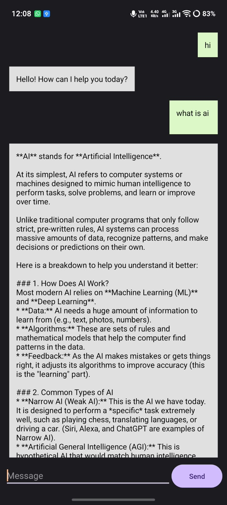

# Simple Gemini AI Chatbot (Android)

A lightweight, clean Android AI Chatbot built using Kotlin, RecyclerView, and the Google Gen AI SDK (Gemini API).

## 📱 App Screenshot

  

## Features
- **WhatsApp-style UI:** User messages on the right (green bubble) and AI responses on the left (gray bubble).
- **RecyclerView Adapter:** Optimized and written with simple, clean identifiers.
- **Gemini Powered:** Uses `gemini-1.5-flash` for fast and intelligent text generation.
